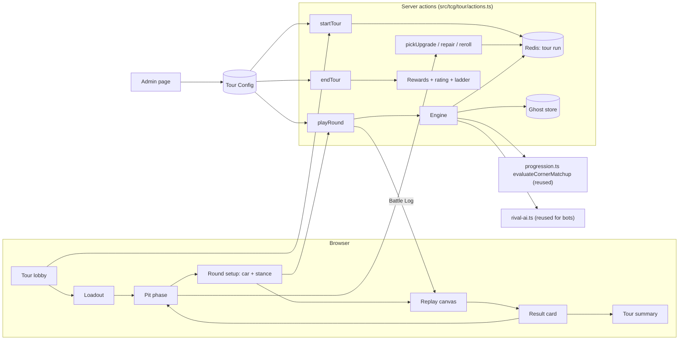

# Design Document

## Overview

Tandem Tour is built as a self-contained module under `src/tcg/tour/`, plus one new tab in the card game, one admin page and one canvas-based replay renderer. It reuses the existing, already-tested corner scoring and rival AI, and adds three new things: server-held run state, ghost matchmaking and a top-down animated replay.

Three decisions shape everything:

1. **The server owns the run.** The browser never sends "I won". It sends choices (loadout, upgrade pick, car, stance). The server resolves each Round with a seeded engine and returns a Battle Log. Today's Tandem Clash trusts the browser's `won` flag; that is fine for a 2-minute mode with small rewards, but not for a ladder with prizes.
2. **The replay only draws.** The client receives a Battle Log (a list of timed events plus per-corner scores) and animates it. It cannot change a result. This also lets the engine run in a simulator (`scripts/tour-sim.ts`) for balancing, the same way `battle-sim.ts` does for Clash.
3. **Opponents are ghosts.** After each Round a member plays, a snapshot of their team and the Stance they chose is saved. Other members face it later. There is nothing live, no waiting and no extra load on the player, yet the Stance they meet was really chosen by a person.

## Architecture



### Reuse map

| Need | Reused from | Notes |
|---|---|---|
| Corner scoring | `src/tcg/progression.ts` `evaluateCornerMatchup`, `rollThreeClashSectors`, `rollUkTrackCard`, `rollThreeDebuffCards` | Pure functions with an injectable `rng`, no `"use client"`. Already used by `battle-sim.ts` outside the browser. |
| Corner types | `src/tcg/clash-corners.ts` (26 types) | Each gets a track geometry in the replay (see Track geometry). |
| Bots | `src/tcg/rival-ai.ts` (`arrangeRival`, `chooseRivalCrew`, `ladderDials`) and `challenges-actions.ts` `buildChallengeOpponent` | Used when no Ghost is found. |
| Crew / debuff / track data | `src/lib/crew-cards.ts` | Unchanged. |
| Repair kit cards | `cardType: "maintenance"` in `MemberCard`, `repairBattles` | Their rarity sets the Condition they restore in a Tour. A kit is deleted from the member's collection when used (idempotent per kit), as repair kits are elsewhere. Unused kits stay. |
| Currency | `spendPCredits`, `grantPCredits` in `src/tcg/storage.ts`; pack credits in `src/lib/card-credits.ts` | No new currency. |
| Early access | `hasClashEarlyAccess` in `src/tcg/clash.ts` | Same gate pattern. |
| Notifications | `src/actions/notifications.ts` | Ladder winners, ghost results. |
| Activity log | `src/lib/activity.ts` | Charges and prizes. |

The Tandem Clash code is **not modified**, apart from adding a `"tour"` value to the `TcgTab` type in `src/tcg/types.ts` and a tab entry in `TcgApp.tsx`.

## File Layout

```
src/tcg/tour/
  types.ts            Tour state, Battle Log, config and ghost types
  config.ts           Defaults + loadTourConfig / saveTourConfig (Redis override, sanitised)
  upgrades.ts         The Upgrade catalogue (data) and offer rolling
  engine.ts           PURE: resolveRound(state, choices, rng) -> BattleLog + new state
  stance.ts           PURE: triangle, bot stance weighting
  condition.ts        PURE: condition multiplier, wear, repair amounts
  ghosts.ts           save / pick / trim ghosts (Redis)
  rating.ts           PURE Elo-style rating + ladder points
  rewards.ts          prize lookup, streak, weekly ladder payout (idempotent)
  actions.ts          "use server" actions (start, pick, repair, reroll, play, resume, end)
  admin-actions.ts    "use server" admin config + economy stats
  replay/
    build-timeline.ts PURE: BattleLog -> keyframe timeline (positions, angles, events)
    track-geometry.ts PURE: corner types -> path segments; builds a course
    renderer.ts       Canvas 2D drawing + rAF loop (no React)
    sprites.ts        Procedural top-down car shapes + smoke/mark particles
  components/
    TourTab.tsx       Lobby
    TourLoadout.tsx
    TourPitPhase.tsx
    TourRoundSetup.tsx
    TourReplay.tsx    React wrapper around renderer.ts
    TourResult.tsx
    TourSummary.tsx
    TourTutorial.tsx
src/app/(admin)/admin/driftclash/tour/page.tsx   + TourAdmin.tsx
scripts/tour-sim.ts   Balance simulator (not shipped to the browser)
```

## Data Models

```ts
export type Stance = "attack" | "hold" | "gamble";

export interface TourLoadoutSnapshot {
  cars: MemberCardSnap[];       // up to 4 (loaners fill gaps), frozen at start
  crew: MemberCardSnap[];       // up to 4
  repairKits: MemberCardSnap[]; // up to 3 (Tour-only copies; not consumed from the collection)
}
// MemberCardSnap is the subset of MemberCard the engine needs (id, tier, stats, cardType, crewCardId, repair fields, name, imageUrl).

export interface TourUpgrade {
  id: string;                    // catalogue id
  rarity: "common" | "rare" | "epic";
  category: "tuning" | "crew_call" | "track_intel" | "pit_stop" | "sponsor";
  roundsLeft?: number;           // for timed effects
  usesLeft?: number;             // for once-per-Tour effects
}

export interface TourRunState {
  id: string;                    // run id (uuid)
  userId: string;
  seed: string;                  // crypto-random, stored; never sent to the client
  status: "active" | "ended";
  step: "pit" | "setup" | "result" | "ended";
  round: number;                 // 1-based
  maxRounds: number;
  strikes: number;
  maxStrikes: number;
  wins: number;
  rating: number;                // rating at start of the run
  loadout: TourLoadoutSnapshot;
  condition: Record<string, number>;   // car id -> 0..100
  usedKits: string[];                  // kit ids spent this Tour
  upgrades: TourUpgrade[];
  offers: string[] | null;             // current 3 upgrade ids (server-rolled)
  rerollsUsed: number;
  facedGhostIds: string[];
  nextOpponent: TourOpponentPreview | null;   // set when entering setup
  stanceHistory: Stance[];
  rounds: TourRoundRecord[];           // short per-round summary
  paid: { freeRun: boolean; pCredits: number };
  startedAt: number;
  updatedAt: number;
  lastActionKey: string | null;        // idempotency key of the last accepted action
}

export interface TourGhost {
  id: string;
  ownerId: string;
  ownerName: string;
  round: number;
  rating: number;
  car: MemberCardSnap;
  crew: MemberCardSnap | null;
  upgrades: TourUpgrade[];
  condition: number;
  stance: Stance;
  createdAt: number;
}

export interface BattleLog {
  roundIndex: number;
  track: { id: string; name: string; theme: string };
  corners: Array<{
    sector: { id: string; name: string; geometry: string };
    player: SideCornerLog;
    rival: SideCornerLog;
    winner: "player" | "rival" | "tie";
  }>;
  stance: { player: Stance; rival: Stance; triangle: "player" | "rival" | "none" };
  upgradesApplied: Array<{ side: "player" | "rival"; upgradeId: string; cornerIdx?: 0 | 1 | 2; text: string }>;
  result: "win" | "loss";
  totals: { player: number; rival: number };
  conditionAfter: { playerCarId: string; before: number; after: number };
  nearMiss?: { by: number; hint: string };
  // Engine-decided animation hints (no randomness needed on the client):
  motion: Array<{ cornerIdx: 0 | 1 | 2; leadSide: "player" | "rival"; gapAfter: number; angleDeg: number; smoke: number }>;
}

export interface TourConfig {
  enabled: boolean;
  earlyAccessOnly: boolean;
  adminsRunFree: boolean;
  maxRounds: number; maxStrikes: number;
  freeRunsPerDay: number; entryPricePCredits: number; maxPaidRunsPerDay: number;
  rerollPricePCredits: number;
  decisionTimerSeconds: number;           // 0 = off
  prizes: Array<{ wins: number; pCredits: number; packCredits: number }>;
  ladderPrizes: Array<{ place: number; pCredits: number; packCredits: number }>;
  streakRewards: Array<{ days: number; pCredits: number; packCredits: number }>;
  multipliers: { ladder: number; streak: number; earlyAccess: number };
  tuning: {
    stanceBonus: number; gambleMin: number; gambleMax: number;
    wearBase: number; wearAttack: number; conditionFloorMultiplier: number;
    repairByRarity: Record<"bronze" | "silver" | "gold" | "legend" | "mythic", number>;
    ratingK: number; ghostsPerRound: number; ratingBand: number;
  };
  upgradeWeights: Record<"common" | "rare" | "epic", number>;
  upgradeOverrides: Record<string, { enabled?: boolean; values?: Record<string, number> }>;
  updatedAt: number;
}
```

Defaults (all initial and tunable in the admin page): 8 rounds, 3 strikes, 1 free run a day, paid entry 50 P-Credits, max 5 paid runs a day, prize table rising from 0 at 0-1 wins to the largest at 8 wins, wear 18 (+8 for Attack), stance bonus 4, gamble swing -3..+6, condition multiplier floor 0.80, repair 20/35/50/100/100, Elo K 24.

### Redis keys (all new, prefix `tcg:tour:`)

| Key | Type | Purpose |
|---|---|---|
| `tcg:tour:config` | string (JSON) | Tour Config override |
| `tcg:tour:config:log` | list | Config change log (capped) |
| `tcg:tour:run:<runId>` | string (JSON), EX 7 days | Run state |
| `tcg:tour:active:<userId>` | string | The member's active run id (SET NX = one at a time) |
| `tcg:tour:ghosts:<round>` | zset (score = rating) | Ghost ids for a Round |
| `tcg:tour:ghost:<ghostId>` | string (JSON), EX 14 days | Ghost snapshot |
| `tcg:tour:profile:<userId>` | hash | rating, bestWins, tours, streak, freezes, lastPlayDate, optOut, dailyLimit |
| `tcg:tour:daily:<userId>:<YYYY-MM-DD UK>` | hash | free runs used, paid runs used, P-Credits spent (EX 3 days) |
| `tcg:tour:ladder:<weekKey>` | zset | weekly points per user |
| `tcg:tour:ladder:paid:<weekKey>` | string | payout done marker (SET NX) |
| `tcg:tour:notes:<userId>` | list | lobby lines ("your team beat…", reactions) capped at 20 |
| `tcg:tour:stats:<YYYY-MM-DD>` | hash | economy counters for the admin panel |
| `tcg:tour:action:<runId>:<key>` | string NX, EX 1 day | idempotency marker for a step |

## The Engine

`resolveRound` is a pure function: `(state, choices, ghost|bot, config, rng) -> { log, nextState }`. It is the only place a result is decided.

### Round resolution

1. Roll three corners (`rollThreeClashSectors`), one track card (`rollUkTrackCard`) and, per corner, a debuff for each side (`rollThreeDebuffCards`), all with `rng` seeded from `hash(state.seed, round)`.
2. For each corner call `evaluateCornerMatchup` with the player's chosen car and a crew card (the crew card is chosen automatically: the best crew for that corner using the same helper the Bot uses, excluding crew already used this Tour more than twice, so crew rotates and the 4-crew loadout matters).
3. Adjust each side's score:
   - Condition: `score * (floor + (1 - floor) * condition / 100)`.
   - Upgrades active this Round (tuning, crew call, track intel effects).
   - Stance triangle bonus.
   - Gamble swing from `rng`.
   - Never below the existing score floor (5).
4. Decide the winner: corners won, then total, then higher rating. No draw.
5. Update Condition (base wear, plus Attack wear), tick down timed Upgrades, record the Stance.
6. Compute `motion` hints: who leads each corner, the gap after it (from the score difference), the drift angle and smoke amount (from the corner's score and Gamble/Attack) so the client needs no randomness.
7. Build the `BattleLog`, including a `nearMiss` hint when lost by 5 or fewer.

The Ghost side uses the Ghost's frozen car, crew, upgrades, condition and Stance. The Bot side uses `arrangeRival` and a weighted Stance.

### Stance triangle

`attack > hold > gamble > attack`. The winning side gets `stanceBonus` per corner. A Bot's Stance is weighted toward countering the member's last two Stances with some noise (`tuning` in the config), so a predictable player is gently punished but never surely beaten.

### Upgrades

A data-driven catalogue in `upgrades.ts` of at least 20 entries. Each has an `id`, `name`, `description`, `category`, `rarity`, `effect` (a small typed object, for example `{ kind: "stat", stat: "grip", amount: 3, rounds: 2 }`, `{ kind: "condition", amount: 25 }`, `{ kind: "reveal", what: "ghostStanceHint" }`, `{ kind: "corner_ban", count: 1 }`) and `values` that the admin can override. Examples:

- Tuning: Fresh Rubber (+3 grip, 2 Rounds), Boost Map (+3 accel, 2 Rounds), Angle Kit (+3 drift, 2 Rounds), Quick Rack (+3 steer, 2 Rounds).
- Crew Call: Hired Spotter (best crew bonus +3 for the next Round), Pit Whisperer (crew flat bonus x1.5 once).
- Track Intel: Walk the Track (see the Ghost's car stats before choosing), Stance Hint (the Ghost owner's most common Stance), Corner Veto (turn one of the three corners into a neutral corner for one Round).
- Pit Stop: Quick Stop (+25 Condition on all cars), Fresh Tyres (+40 Condition on the car you choose), Mechanic's Favour (double the next repair kit).
- Sponsor: Cash Sponsor (+10% on the final prize if you finish above 4 wins), Free Reroll, Insurance (turn one lost Round into no Strike, once).

Offers: 3 distinct enabled upgrades drawn by weighted rarity from the seed, excluding ones the member already holds at full stacks.

### Condition

`condition.ts`: `multiplier(c)`, `wear(round, stance, config)` and `repairAmount(kit.tier, config)`. Condition lives only in `TourRunState`. Real cards are never changed.

## Ghosts and Matchmaking

- **Save**: after `playRound` resolves, `saveGhost` stores a `TourGhost` for the Round the member just played, using the Stance they chose, and adds its id to `tcg:tour:ghosts:<round>` with score = their rating. If the zset holds more than `ghostsPerRound`, the lowest-age entries are removed with `ZREMRANGEBYRANK` on a time-ordered side list.
- **Pick**: `ZRANGEBYSCORE` for ratings in `[r - band, r + band]` (default band 150), choose a random id on the server, skip own and already-faced ghosts, widen the band by 150 up to 4 times, then fall back to a Bot. Reading is one `ZRANGEBYSCORE` plus one `GET`.
- **Opt-out**: members with `optOut` are not saved. Existing ghosts are removed lazily when picked (owner lookup in the profile hash).
- **Privacy**: the Ghost carries only a display name. The member sees the name, car name, car rarity and rating.

Because ghosts are per Round number, the very first members have no Ghosts. The Bot fallback covers that, and an admin switch can pre-seed Bots as Ghosts.

## Rating and Ladder

- Rating change per Round: `K * (result - expected)` where `expected = 1 / (1 + 10^((ghostRating - rating) / 400))`; summed over the Tour and applied once at the end. Rating floors at 100. Bots count as a rating equal to the member's rating (so they barely move it).
- Ladder points for the week: `wins * 10 + (tourCompleted ? 5 : 0)`, added to `tcg:tour:ladder:<weekKey>` where `weekKey` is the ISO week in `Europe/London`.
- Weekly payout: a cron route (a new `/api/cron/tour-ladder`, protected by `CRON_SECRET`, run Monday 00:05 UK) reads the top N, guards with `SET NX tcg:tour:ladder:paid:<weekKey>`, grants prizes and sends notifications.

## Rewards, Pricing and Streaks

- `startTour` does, in order: check config and access, check no active run (`SET NX tcg:tour:active:<userId>`), check the daily record, decide free or paid, spend P-Credits with `spendPCredits` (which is atomic), build and store the run state, and on any failure after the spend, refund and release the active key. All of it runs in one server action and is keyed by an idempotency key from the client.
- `endTour` runs once (marker `SET NX tcg:tour:action:<runId>:end`), looks up the prize for the Win Count in the config, applies multipliers, grants P-Credits and pack credits, updates rating, ladder, streak and daily stats, writes the activity log, and releases the active key.
- **Prizes are deterministic.** Surprise comes from free upgrade drafts, never from a paid prize roll. This avoids paid randomised rewards. (This is a design principle, not legal advice; the owner should check local rules for in-game currency that can be bought with real money.)
- Streak: `lastPlayDate` (UK) and `streak` in the profile. Playing on the next day extends it; missing exactly one day uses a freeze if available, otherwise resets to 1. Freezes are granted every 7 days up to 2.
- The admin page edits `TourConfig` through `saveTourConfig` (admin-checked, validated with the same sanitising approach as `sanitizePackConfig`) and appends to the change log.

## Server Actions (`actions.ts`)

All are `"use server"`, return the existing `ActionResult<T>`, check the session, the config and the rate limit, and take a client-generated `actionKey` for idempotency.

| Action | Does | Returns |
|---|---|---|
| `getTourLobby()` | profile, daily status, config view (prices, prize table), ladder rank, notes, active run summary | lobby view |
| `getTourEligibleCards()` | member's selectable cars, crew, kits | cards |
| `startTour({ loadout, actionKey })` | validates, charges, creates run | run view (step "pit", offers) |
| `getActiveTour()` | resume | run view |
| `pickUpgrade({ runId, upgradeId, actionKey })` | keeps one offered upgrade | run view |
| `rerollOffers({ runId, actionKey })` | free once or charged | run view |
| `useRepairKit({ runId, kitId, carId, actionKey })` | deletes the kit card from the collection (once), restores Condition | run view |
| `beginRound({ runId, actionKey })` | picks the opponent, moves to "setup" | opponent preview + next track info |
| `playRound({ runId, carId, stance, actionKey })` | resolves, saves ghost, updates state | Battle Log + run view |
| `continueAfterRound({ runId })` | moves to "pit" or ends | run view or summary |
| `endTour({ runId })` | prizes, rating, ladder (also called by the idle sweeper) | summary |
| `sendReaction({ ghostId, reaction })` | preset reaction to the owner's notes | ok |
| `setTourPrefs({ optOut, dailyLimit })` | member prefs | ok |

The client view of a run (`TourRunView`) **omits** the seed, other members' ids and the Ghost's Stance until after the Round.

An idle sweeper (cron `/api/cron/tour-sweep`, hourly) ends any run idle for over 24 hours (Requirement 3.7).

## Replay (Top-Down Canvas)

### Why canvas and no library

The scene is a few moving shapes, particle puffs and a camera; there is no physics. Canvas 2D with `requestAnimationFrame` handles that at 60fps on phones without adding a dependency (`package.json` has none for animation). The renderer lives outside React (`renderer.ts`) and `TourReplay.tsx` only mounts a `<canvas>`, feeds it the timeline and owns the controls. If testing on low-end phones shows problems, the options are an offscreen canvas or reducing particles, not a new library.

### Timeline

`build-timeline.ts` converts the `BattleLog` into a list of keyframes at fixed times (about 22 seconds at 1x): intro and rolling start, then for each corner an approach, entry, apex, exit with score pop-up; a role swap at the half-way point (so both cars lead once, like real tandem judging); a finish line sequence. All values come from `motion` hints and corner scores. It uses easing and spline interpolation only, no randomness, so the same log always plays the same way. The timeline also lists events: stance reveal, upgrade triggers, debuff hits, near-miss "sparks".

### Track geometry

`track-geometry.ts` maps each of the 26 corner ids to one of 6 base shapes (`sweeperL`, `sweeperR`, `hairpin`, `chicane`, `kink`, `longEntry`), each defined as a short path of cubic segments with a width. A course is the three shapes joined by short straights, normalised to fit the canvas, with a seeded decorative layer (barriers, cones, crowd blocks) chosen from the track card's theme (10 UK tracks give colours, surface and props). Rendering draws the road, kerbs, tyre marks (a persistent offscreen layer that is drawn into as cars pass), then cars, smoke, then the HUD.

### Cars

Top-down cars are drawn procedurally (a rounded body, wheels, a roof shape and a livery colour taken from the card's frame colour or the team name hash). The card art appears in the HUD name plates and the result card, not on the road (card art is not top-down). Smoke is a particle emitter with a pool of about 120 sprites. A simple camera lerps toward the midpoint of the two cars and zooms with their gap.

### Controls and accessibility

- Skip, 1x/2x speed and replay buttons, all keyboard reachable.
- `prefers-reduced-motion`: show a card-by-card corner summary with the same data, no continuous animation.
- A visually hidden `aria-live` region narrates each corner ("Corner 2: you led, scored 41 to 38").
- The renderer stops its loop when the document is hidden and when the component unmounts. It measures frame time and lowers particle count and effects if the average frame takes over 24 ms.

## UI Flow

1. **Lobby** (`TourTab`): rating, streak, daily free run, price, weekly rank, prize table, notes ("Your team beat Sam"), Start.
2. **Loadout**: pick up to 4 cars, 4 crew, 3 kits with an "Auto-pick best" button and clear reasons for ineligible cards.
3. **Pit Phase**: 3 upgrade cards with a flip-in animation, reroll, repair kits, and the preview of the next Round.
4. **Round Setup**: pick the car (with Condition bars) and the Stance, with the triangle shown. Optional timer.
5. **Replay**: the canvas, with controls.
6. **Result card**: scores per corner, reasons, Ghost's Stance, reaction buttons, near-miss hint, Condition change, "Continue".
7. **Summary**: Win Count, prizes, rating change, ladder position, "Run it again".

The first two steps reuse the existing card display components (`FullArtCard`) and the existing panel styling. Colours and type follow the current game tabs.

## Security and Integrity

- Seeds are created with `crypto.randomBytes` and never leave the server. Results cannot be forged because the client sends no outcome.
- Every action checks `session.user.id === state.userId`, `state.step`, and that ids come from the stored state.
- Idempotency: `SET NX tcg:tour:action:<runId>:<key>` before any effect; the stored result is returned on repeat.
- Rate limit: a Redis counter per member per minute (30).
- Charges and prizes go through one code path each and are written to the activity log with the run id.
- The seed and choices are in the run record for 7 days, so a disputed result can be replayed with `scripts/tour-sim.ts --run <id>`.
- The admin page uses the existing `requireAdmin` pattern.

## Error Handling

- Redis failure inside `startTour` after a spend: refund, release the active key, return a retry message.
- Engine or renderer exception: state is only written after the Engine returns, so a failure leaves the Tour on the same step; the client shows "Something went wrong, tap to retry".
- Missing card (deleted since the snapshot): the snapshot holds the data, so the run continues.
- A Ghost's data is invalid: skip it and pick another, then fall back to a Bot.
- Config missing or invalid: load defaults and log a warning; the mode stays off if `enabled` is not true.

## Testing and Balance

- `scripts/tour-sim.ts` plays thousands of Tours between bot loadouts of various rarities with the real Engine, printing win-count histograms and prize cost per paid run. Targets (initial): a median-strength member averages 4 wins; paying runs return about 85% of the entry price in P-Credits on average (an adjustable sink); a bronze-only member can still reach 3 wins.
- Pure functions (`stance.ts`, `condition.ts`, `rating.ts`, `resolveRound`, `build-timeline.ts`, `track-geometry.ts`) get unit tests: determinism, stance triangle, condition bounds, prize lookup, rating symmetry, timeline duration bounds.
- Action tests with a Redis mock for idempotency, one-active-run, refund on failure and the daily limit.
- Manual device checks for the replay on an iPhone (Safari and PWA), a mid-range Android and desktop, including reduced motion.

## Rollout

1. Build the server and engine and a plain (non-animated) UI first, behind `earlyAccessOnly`, so the loop can be played and balanced.
2. Add the animated replay.
3. Add the admin page, ladder, streak and social touches.
4. Tune with the simulator and early-access feedback, then open to everyone.

## Open Questions

- Decided: repair kits are consumed when used (owner decision). Unused kits stay in the collection.
- Should members be able to use the same car every Round? The design allows it, with Condition wear as the cost.
- Which prize table and paid-entry price to launch with? The defaults are placeholders for the owner to set in the admin page.
